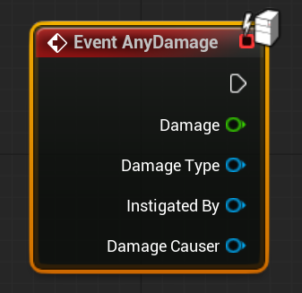

# Unreal: Damage System: What is the damage system?

> Legacy lesson, organized for self-study. Screenshots may show an older editor. See the Unreal 5.8 verification scope (legacy attachment omitted) before relying on version-specific steps.

It is always helpful to remember that Unreal the game engine arose because of work on *Unreal* (1998) the game. This means there is functionality remaining from the early work on shooter games still in the engine itself. A prime example of this is the [Damage system.](https://dev.epicgames.com/documentation/en-us/unreal-engine/BlueprintAPI/Game/Damage)

## Actors Can Take Damage

There are multiple nodes for dealing with damage in many forms:

- [On Take Any Damage](https://dev.epicgames.com/documentation/en-us/unreal-engine/BlueprintAPI/Game/Damage/OnTakeAnyDamage)
- [Apply Damage](https://dev.epicgames.com/documentation/en-us/unreal-engine/BlueprintAPI/Game/Damage/ApplyDamage)

When an actor "takes" damage, this is translated into a float number passed to the event.

*Figure: Screenshot of Event AnyDamage.*
