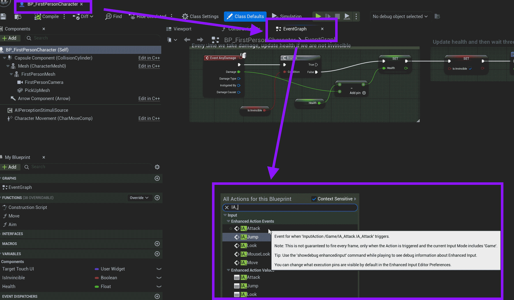
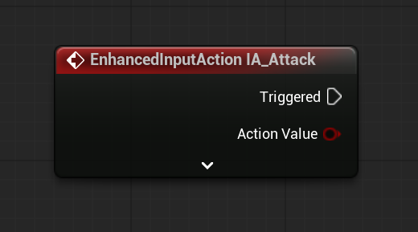

# Unreal: Example: Adding an Attack: Responding to IA_Attack Event

> Legacy lesson, organized for self-study. Screenshots may show an older editor. See the Unreal 5.8 verification scope (legacy attachment omitted) before relying on version-specific steps.

With the added input action, we can use it as part of the Character class using those input mapped context (IMC) files.

Depending on the template, this may be Third Person or First Person.

Search for this Blueprint. Double-click this to open it in the Blueprint Editor.

In the Event Graph, right-click and search for "IA_Attack"

*Figure: Screenshot of searching for IA_Attack.*

With the added node, we can respond to the input.

*Figure: Screenshot of input action IA_Attack.*
