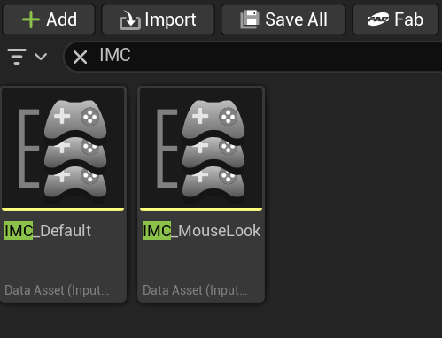
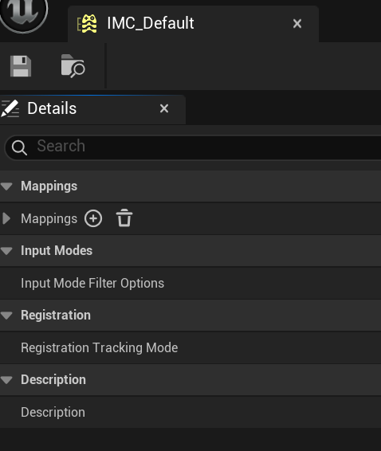
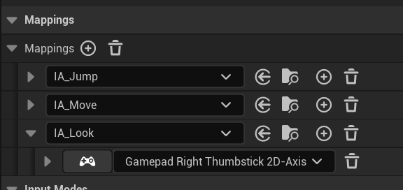
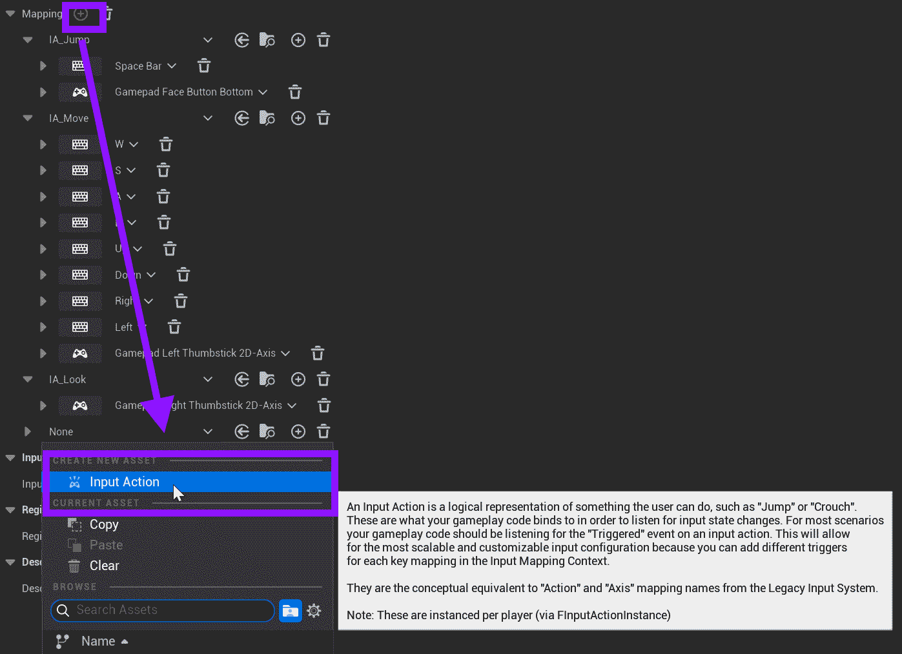
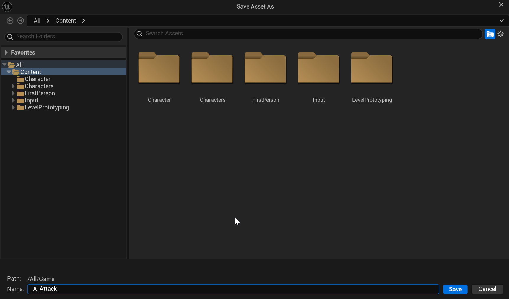
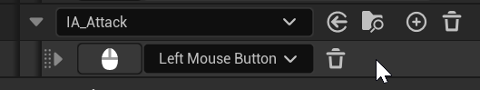

# Unreal: Example: Adding an Attack: Updating Input

> Legacy lesson, organized for self-study. Screenshots may show an older editor. See the Unreal 5.8 verification scope (legacy attachment omitted) before relying on version-specific steps.

In Unreal, inputs are "mapped" to a named event. When any of those inputs happen, the "mapped" event will be triggered.

These are named Input Mapped Context or IMC for short.

## Adding Mapped Input

Search for the IMC in your current template.

*Figure: Screenshot of search for IMC in the Content Drawer.*

Double-click on IMC_Default to open the default mapped inputs.

IMC_Default is an example of *data* Blueprint. It does not have events itself. Instead, it is a list of values used by other Blueprints.

*Figure: Screenshot of data blueprint view.*

To see the Mapping, click the drop-down on Mapping.

*Figure: Screenshot of Mapping and named events.*

The naming convention here is to use "IA" for Input Action and then the name of the action. For example, "IA_Jump" is input action jump.

Next to Mappings, click on the plus symbol to add an input action.

On the drop-down, select Input Action.

*Figure: Screenshot highlighting the selection of Input Action.*

Save this new input action as the named *IA_Attack*.

*Figure: Saving named input action IA_Attack.*

## Setting Input Action *Attack*

Click the button under the named IA_Attack input action. This will listen for input. Left-click on it.

*Figure: Screenshot of created IA_Attack set to left-click.*

File -\> Save.
