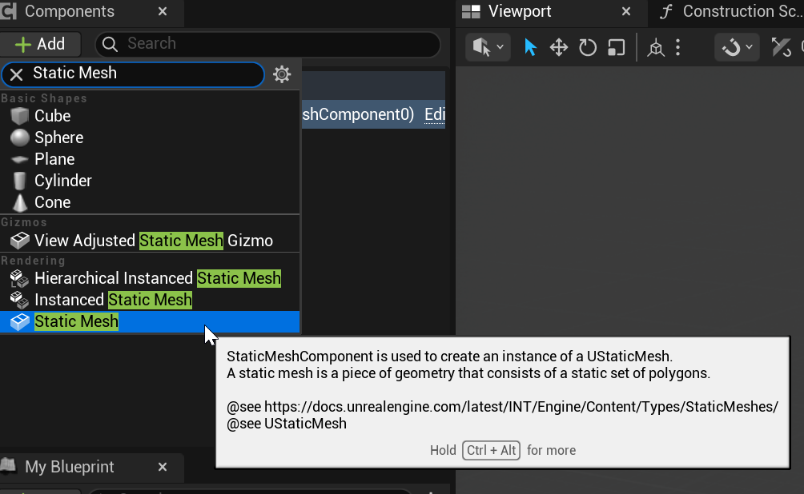
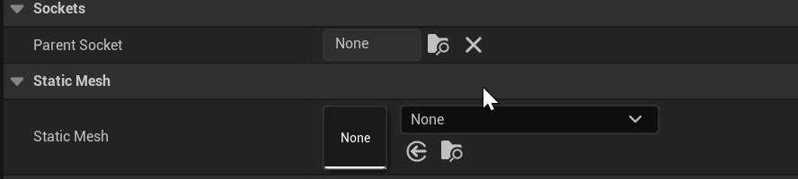

# Unreal: Interactions: Sockets: Adding Meshes to Meshes

> Legacy lesson, organized for self-study. Screenshots may show an older editor. See the Unreal 5.8 verification scope (legacy attachment omitted) before relying on version-specific steps.

Remember, there are two parts. The parent and the child. The parent must have the socket and the child must be socketed.

## Import or create a mesh

Before we can socket something, it must first exist. Start by importing or creating a new mesh.

### Create a Socket on the Skeleton

**For Skeletal Meshes:**

1.  Open the skeletal mesh in the Skeletal Mesh Editor.
2.  In the Skeleton Tree panel, right-click on a bone.
3.  Select "Add Socket" from the context menu.
4.  Name your socket (e.g., "RightHandSocket", "HeadSocket").

**For Static Meshes:**

1.  Open the static mesh in the Static Mesh Editor.
2.  Open the Socket Manager from the Window menu.
3.  Click "Create Socket".
4.  Position the socket using the translation/rotation widgets or the Details panel.

Save either change

## Socketing Mesh

Once the socket is created, open the parent actor in the editor.

Add a "static mesh" component.

*Figure: Screenshot of adding a static mesh component to an actor.*

Once the Static Mesh component is added, use the Parent Socket to select where the new mesh child should be attached to the parent actor.

*Figure: Screenshot showing the Parent Socket field.*
