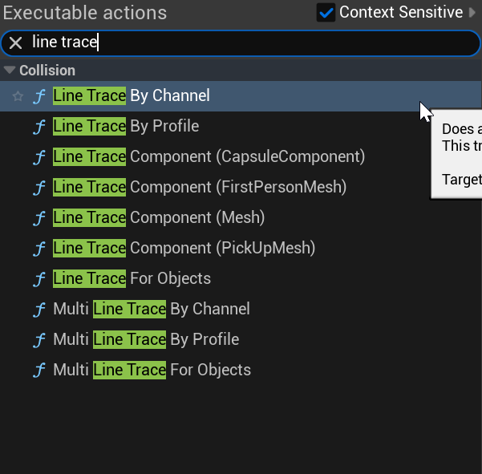

# Unreal: Line Trace: What is a raycast (line trace) in Unreal?

> Legacy lesson, organized for self-study. Screenshots may show an older editor. See the Unreal 5.8 verification scope (legacy attachment omitted) before relying on version-specific steps.

## *What is a raycast?*

We often think about collision detection as a form of radar. We can detect when one thing "bumps into" another as part of some event. If an overlap happens, the two actors have touched in some way.

In the same metaphorical terms, a raycast is a laser. It is an exact, pixel-length "shot" from one location to another. While a collision is mostly accurate for larger things, a raycast is very accurate. However, it also comes at a cost. For the laser, it can "touch" (pass-through) a large number of things on its way from one location to another. While we can use it, we need to be smart about its usage to prevent performance issues.

We often use raycasts for things like:

- Checking line-of-sight (Can one actor "see" another?)
- Detecting surfaces (Is the player-character "near" a ladder or wall?)

## How raycasts work in Unreal Engine 5

In Unreal Engine 5, raycasts are implemented through the collision system and can be performed using several methods:

### Line Traces

The most common raycast implementation uses **Line Trace** functions, which cast a ray from a start point to an end point. UE5 provides various line trace options:

- **Line Trace by Channel**: Traces against specific collision channels (e.g., visibility, camera, pawn).
- **Line Trace by Object Type**: Traces against specific object types (e.g., static meshes, characters).
- **Multi Line Trace**: Returns all objects hit along the ray path, not just the first.

*Figure: Screenshot of Live Trace nodes.*
