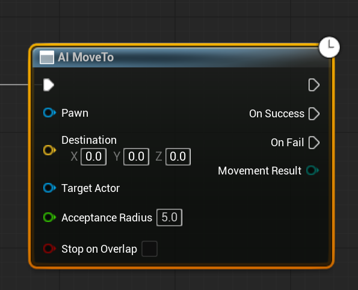
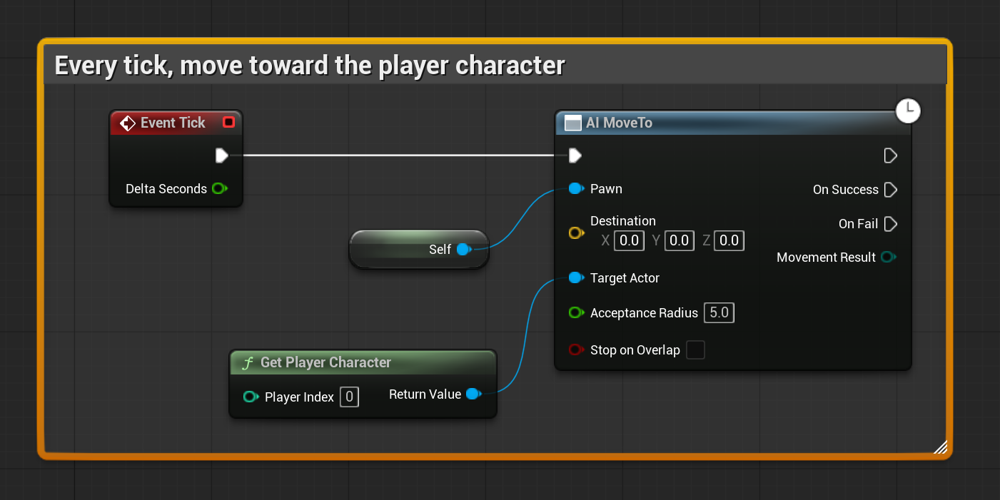
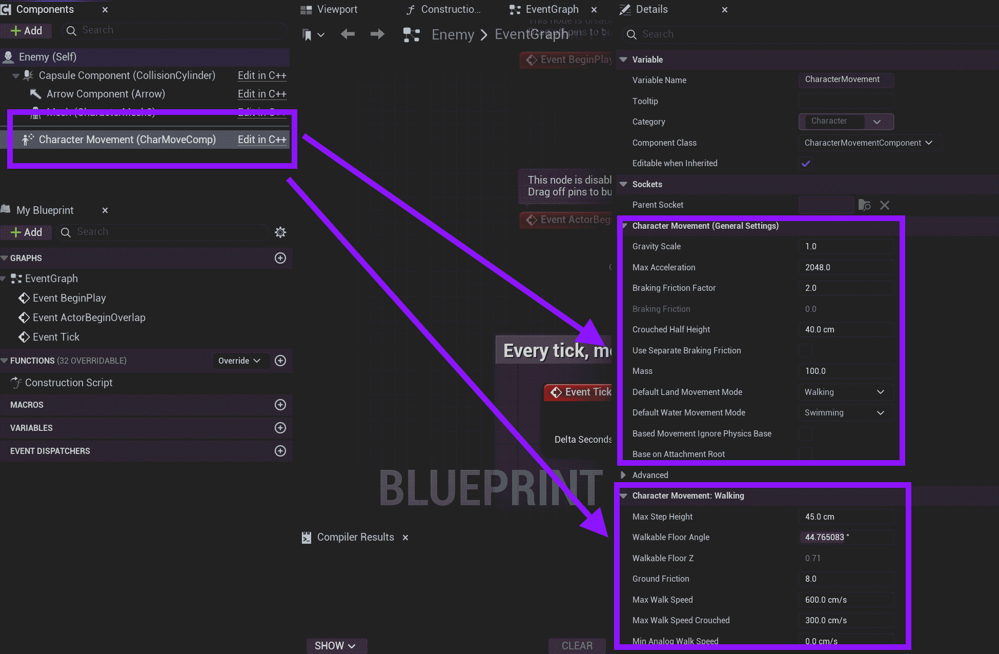

# Unreal: Nav Mesh: AI: AI MoveTo Node

> Legacy lesson, organized for self-study. Screenshots may show an older editor. See the Unreal 5.8 verification scope (legacy attachment omitted) before relying on version-specific steps.

A Character can be told to "move" in level, but it needs to know where it can move. This is where the use of the Nav Mesh Bound Volume comes into play. By defining the spaces where it can move, the AI MoveTo node can be used to tell an actor not under control of the player to "move" to some location.

*Figure: Screenshot of AI MoveTo node.*

This node needs to know what to move (Pawn) and then the Destination (x, y, and z) OR the Target Actor. When it reaches a range, it will stop. This is the Acceptance Radius as a float value.

> **Reminder**: A Character is a Pawn but an Actor is not. You must create either a Pawn or Character or create a Blueprint from an actor based on the Pawn or Character class.

## Example: Created Character + Skeletal Mesh + AI Move To

An easy way to have a Character chase the player-character is to set it as the *Target Actor*.

*Figure: Screenshot of the sequence using AI MoveTo node.*

### Character Movement component

A Character is a Pawn with the *Character Movement* component. This defines how fast it moves and other settings. To change its movement settings, select it and then edit its values in the Details tab.

*Figure: Screenshot highlighting the Character Movement component.*
