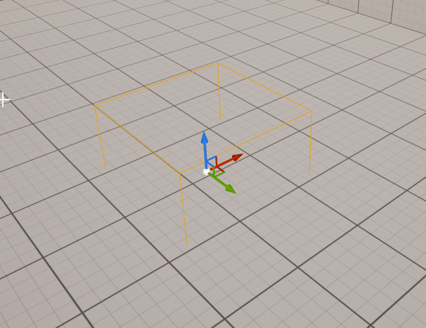
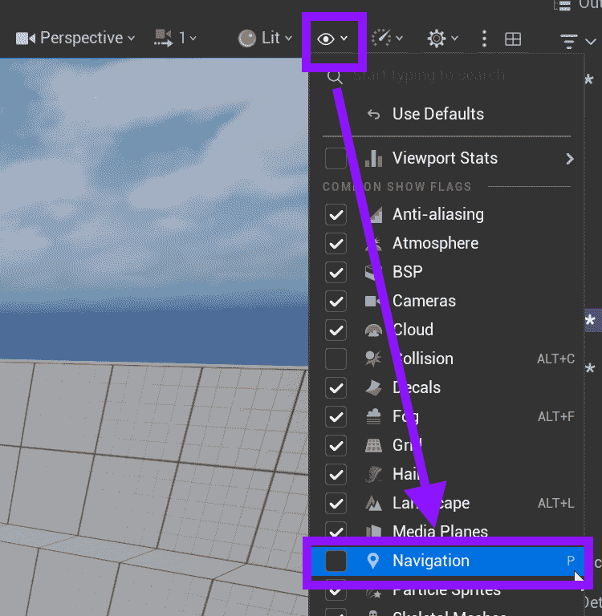
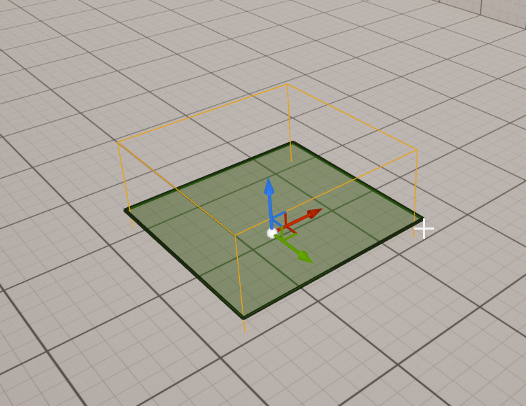
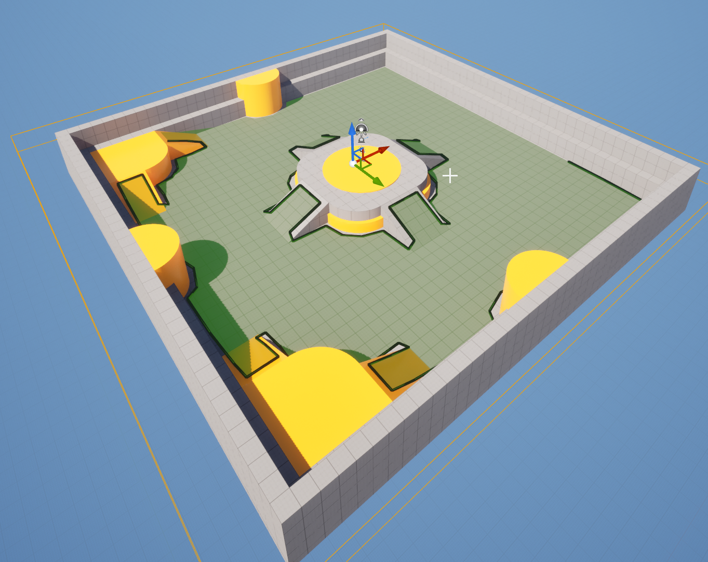

# Unreal: Nav Mesh: What is a navigation mesh (volume)?

> Legacy lesson, organized for self-study. Screenshots may show an older editor. See the Unreal 5.8 verification scope (legacy attachment omitted) before relying on version-specific steps.

The term "navigation mesh" can sometimes be thrown around when discussing video games and their design. Specifically, a **mesh** is some three-dimensional shape. When we combine it with *navigation*, we are describing the division of a larger space into smaller ones where the action of **pathfinding** can occur.

Consider the following problem: you find yourself on one side of a living room and need to move to the other side for some reason. Between you and your destination might be all manner of things: a couch, other people, or maybe some pets. What you are attempting to do, when looking from your current position to some goal, is to *find a path*.

Let's change the scenario slightly. Let’s say you could not perceive your destination directly. All you knew was where you were and how close or not you were to the final location. There is no light, no smells, and all sounds are gone. How would you move from your current position to the goal? One way you might approach trying to do this would be to take a step in a random direction and check to see if you are closer to your goal. If you are, great; take another step. If not, try a step in a different direction.

In a digital space, the calculations involved in pathfinding are very similar to what was just explained. However, there is one small thing a computer can use humans are not as great at doing: fast calculations. A computer knows the destination as a set of coordinates in a finite space. It attempts a series of calculations, what is called *pathfinding*, between the two points. Then it tries again. It might try many times very quickly and then take the best, most efficient path to the goal across the space.

## Navigation Mesh and Pathfinding

When we use a navigation mesh in a digital space, we are applying a large number of different possible steps across the space at fixed intervals. Whenever the computer needs to find a path from one position to another, it uses pathfinding between them. If the location is beyond the space, it will move right up to the edge.

This has been defined more mathematically than practically so far but this is the process by which non-player characters generally move in digital spaces. We define the space, the navigation mesh, and then the computer sorts out how to move a character from one location to the next based on calculations of points within the navigation mesh.

## NavMesh Volume

When describing something filling a three-dimensional space, we often use the term *volume*. In Unreal, many things are volumes to help us, as humans, understand how they "fill the space" they occupy.

A common example of this is a navigation mesh. It "fills" the space it occupies. Everything inside of it is filled by the ability to be navigated by the mesh it supplies for those actors wanting to use it.

In Unreal, what is called a "NavMesh" (short for "Navigation Mesh") Bound Volume can be added to a level. This is a volume, it fills up the space, and is bound, meaning it is finite to whatever it contains.

In the Place Actors panels, searching for "nav mesh" will show this actor:

*Figure: Screenshot showing the search for "Nav Mesh".*

Dragging and dropping this volume in a level seems to drop a transparent cube:

*Figure: Screenshot of placed Nav Mesh Bound Volume.*

When looking at the Viewport in the Unreal Editor, press ‘P’ or go to Show → Navigation to enable a change of color:

*Figure: Screenshot highlighting the selection of Show -\> Navigation option.*

The green color is the navigation mesh.

*Figure: Shaded navigation mesh on the "top" of the mesh.*

In its default shape, it is not particularly useful. However, it can be scaled to include the entire level. Something strange happens when the navigation mesh covers the entire level:

*Figure: Screenshot showing the navigation mesh on the "top" side of the meshes.*

In the new scaling, the navigation mesh fills the entire space. Yet, the color green only appears "on top" of the shapes in the space. This is purposeful. Trying to solve pathfinding in three dimensions requires more math and time. It is very rare for a level to require something to move in three directions at the same time. Most levels have a "floor" on which the navigation mesh can place a two-dimensional mapping onto the three-dimensional shapes.

Put another way: this will solve 90% of all use cases where a navigation mesh is needed. In the other 10%, there are other, faster ways to move around in three-dimensions. There’s no reason to waste time on extra math when we will rarely need it.
