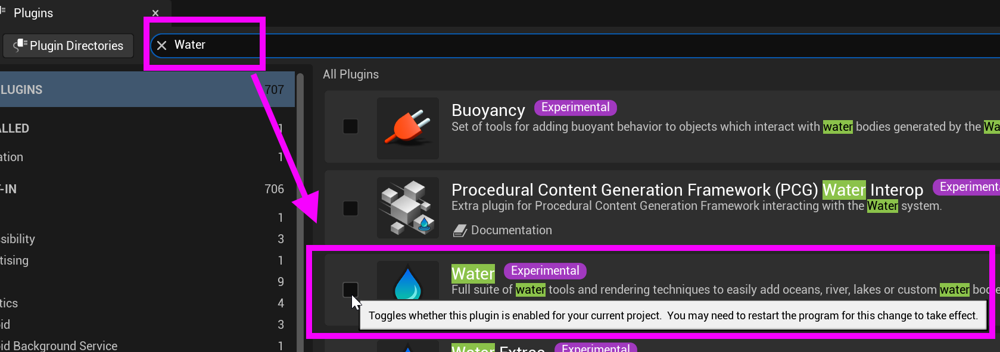

# Unreal: Landscape: Adding Water

> Legacy lesson, organized for self-study. Screenshots may show an older editor. See the Unreal 5.8 verification scope (legacy attachment omitted) before relying on version-specific steps.

In Unreal 5, water is an actor. It is placed alongside or as part of landscape. Once you have landscape prepared, you can add *water* as an actor to the level.

### Adding the Water Plugin

Enable the Water Plugin:

1.  Go to Edit → Plugins.
2.  Search for "Water".
3.  Enable the Water plugin.
4.  Restart Unreal Editor.

*Figure: Screenshot showing the search for Water plugin.*

### Adding Water Bodies

Once the plugin is enabled, you can add various water types:

Water Body Lake:

1.  In Place Actors panel, search for "Water Body Lake".
2.  Drag into your level.
3.  Scale and position over your landscape.
4.  The water automatically carves into the landscape terrain.
5.  Adjust spline points to shape the lake.

Water Body River:

1.  Add Water Body River from Place Actors.
2.  Edit the spline curve to define river path.
3.  River flows along the spline.
4.  Automatically creates riverbed in landscape.
5.  Adjust width and depth in Details panel.

Water Body Ocean:

1.  Add Water Body Ocean for large bodies of water.
2.  Covers large areas with infinite ocean simulation.
3.  Includes wave simulation and foam.
4.  Set Wave Height and Speed in Details.

### Chasing Waterfalls

1.  Sculpt a cliff or drop
2.  Add Water Body River that goes over the edge
3.  Configure waterfall settings in Water Body details
4.  Add particle effects for splash (optional)

## Warning: Adding multiple water actors is performance intensive!

With multiple water actors, Unreal will need to compute multiple things per frame and while the editor is running. It is *highly* advised to use world partition and only load sections you are using rather than vast oceans or multiple rivers at a time.
