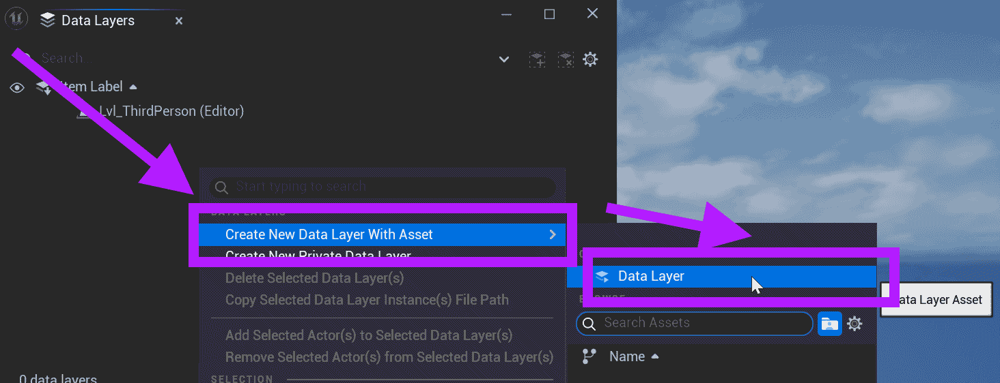
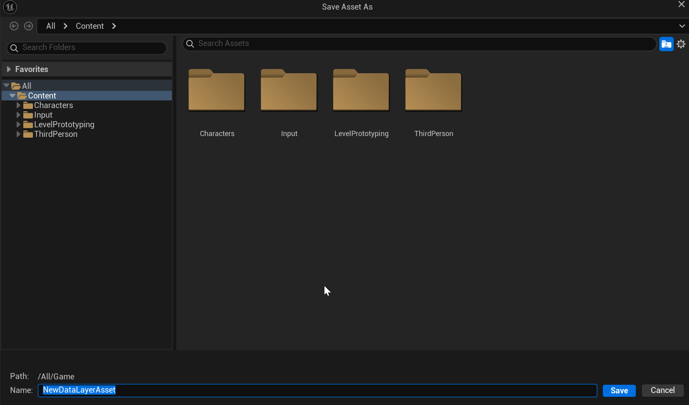
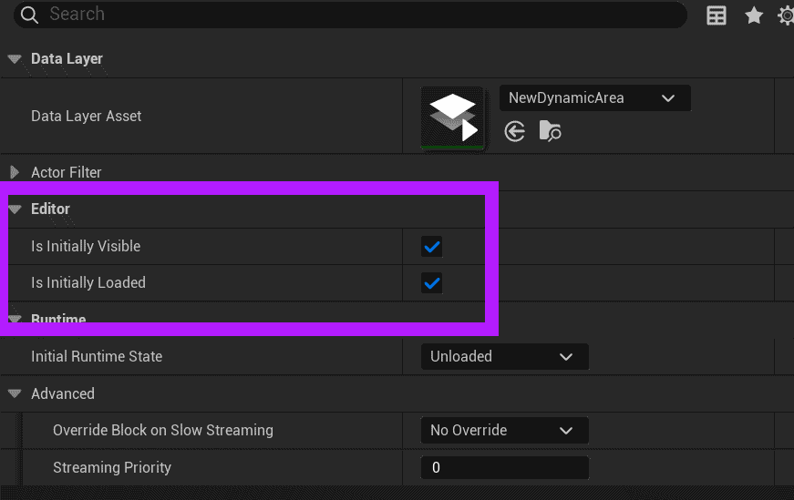

# Unreal: World Partition: Data Layers: Adding a Data Layer

> Legacy lesson, organized for self-study. Screenshots may show an older editor. See the Unreal 5.8 verification scope (legacy attachment omitted) before relying on version-specific steps.

## Adding Data Layer

After opening the Data Layers Outliner, you can create a data layer directly.

(You can also create an asset directly in the Content Drawer and then later connect it.)

Select an actor in the Outliner.

Right click in the Data Layers Outliner and go to Create New Data Layer With Asset.

*Figure: Screenshot highlighting the creation of a data layer.*

Name the data layer in the next screen.

*Figure: Screenshot of saving the new data layer.*

## Setting Visibility

If the actor is activated in the level when added to the data layer, it will also be activated. The layer will have its "Is Initially Visible" and "Is Initially Loaded" options enabled.

*Figure: Screenshot highlighting the visibility and loaded states.*
