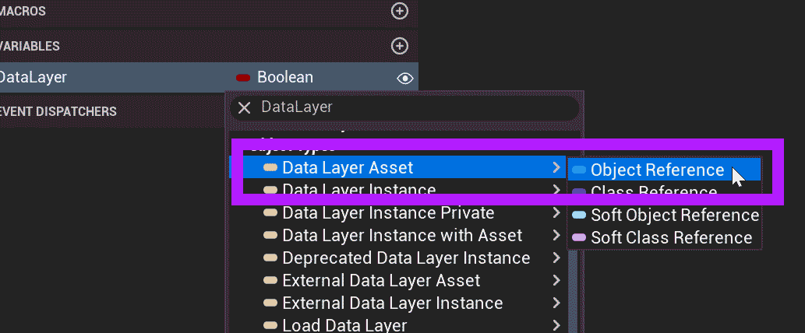
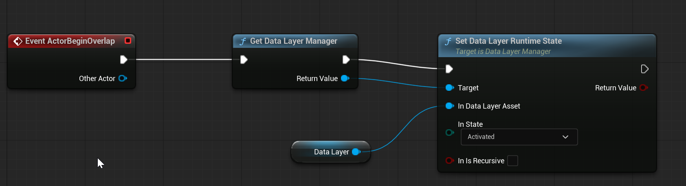
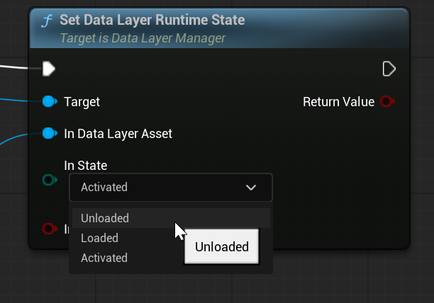

# Unreal: World Partition: Data Layers: Loading a Data Layer

> Legacy lesson, organized for self-study. Screenshots may show an older editor. See the Unreal 5.8 verification scope (legacy attachment omitted) before relying on version-specific steps.

Every data layer has an "editor" and "runtime" status. If we want to dynamically load a data layer, we need to know the asset defining it and then ask the data layer system (manager) to load it for us.

## Example: Trigger for Dynamic Loading

The node **Get Data Layer Manager** is global. This means it can be used in many graphs. (If the level is not using the world partition, it will not work.)

Right-click on the graph. Search for **Get Data Layer Manager**.

Create a variable of the type "Data Layer Asset"

*Figure: Screenshot showing the Data Layer Asset type.*

Name this variable *Data Layer*.

Drag and drop the variable, getting its value.

Pull off the **Get Data Layer Manger** node's return value and search for "Set Data Layer Runtime State".

Connect the Data Layer asset to the **Get Data Layer Manger** node's input.

Change the *In State* to "Activated"

The final sequence will appear as the following:

*Figure: Screenshot of use of Get Data Layer to load specific Data Layer.*

## Unloading

To unload, change the *In State* value to "Unloaded"

*Figure: Set Data Layer Runtime State to "Unloaded"*
