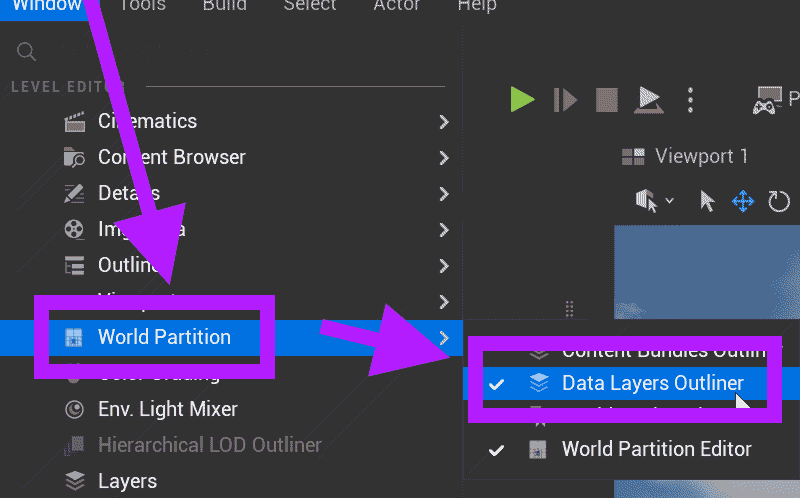
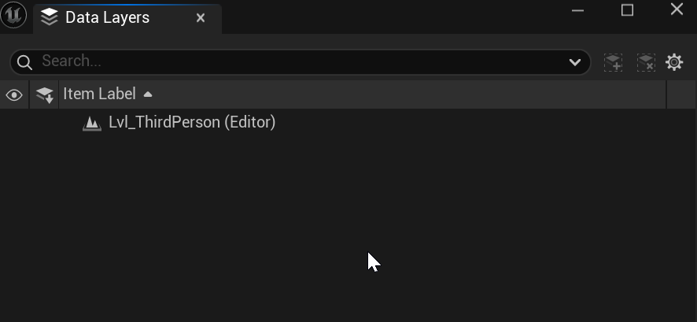

# Unreal: World Partition: Data Layers: What is a data layer?

> Legacy lesson, organized for self-study. Screenshots may show an older editor. See the Unreal 5.8 verification scope (legacy attachment omitted) before relying on version-specific steps.

In an older version of Unreal, you were able to load levels into levels. As part of the new World Partition functionality in Unreal 5, we can define a large world of different cells. We can also define more granular controls through a concept known as a *data layer*.

## *How does a data layer work?*

A data layer describe a "layer" of actors to be applied to a world. Think of it as dynamic loading of content. Based on some action like a player-character walking into a doorway or the enabling of a quest, some content will be loaded into the world as part of some layer. We define the layer and the action. When it happens, or as part of something else, the data layer will be loaded into the world.

## Accessing Data Layers

In Unreal, the Data Layers window can be found under Window -\> Data Layers.

*Figure: Screenshot highlighting use of World Partition -\> Data Layers Outliner.*

With no data layers defined, the Outliner will not show anything.

*Figure: Screenshot of Data Layers Outliner.*
