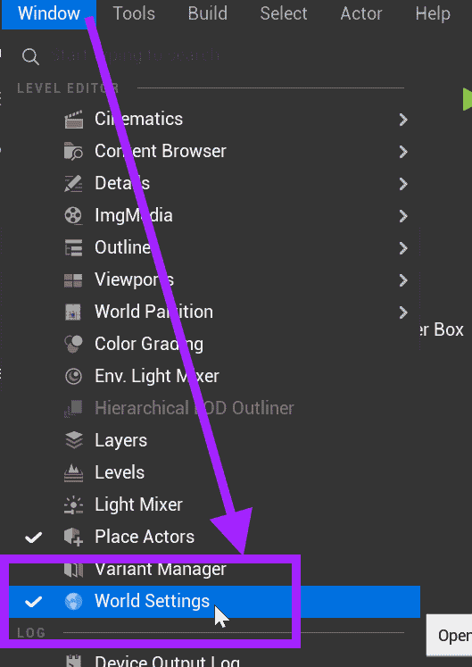
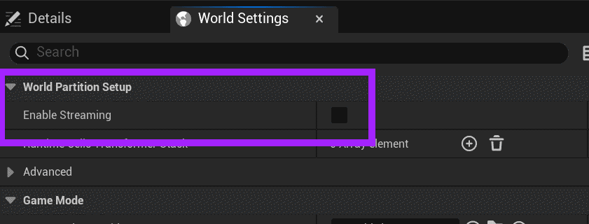
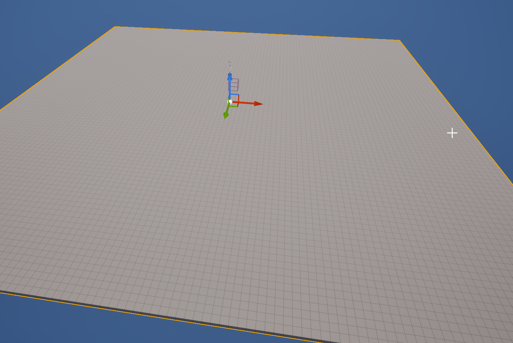
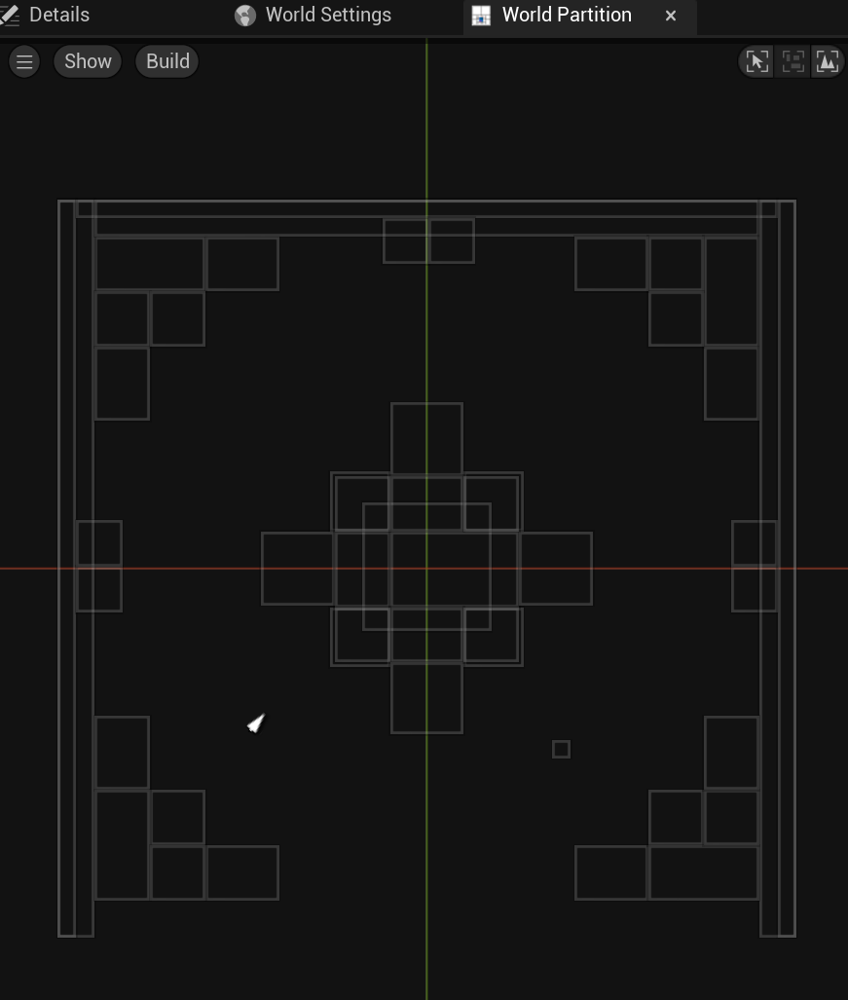
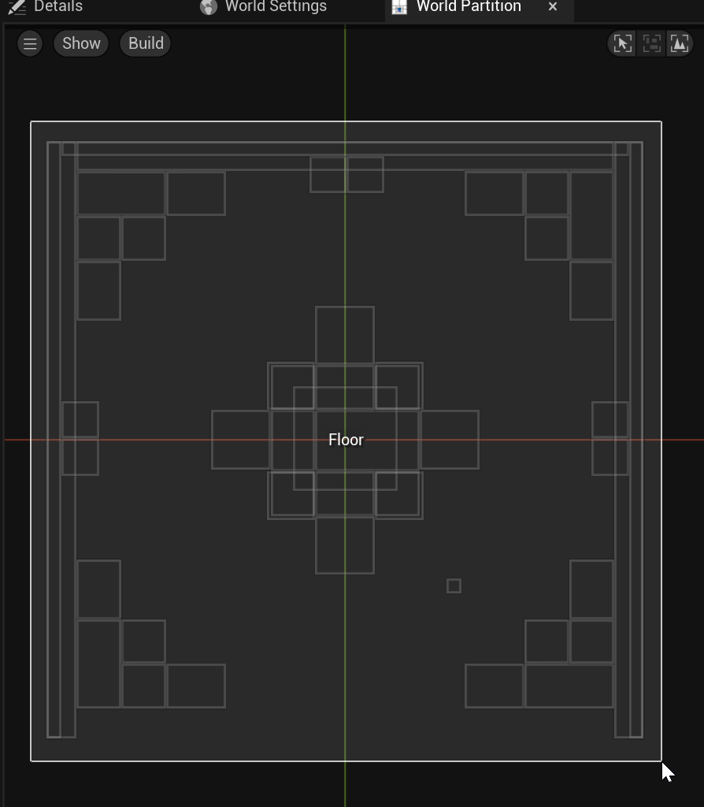
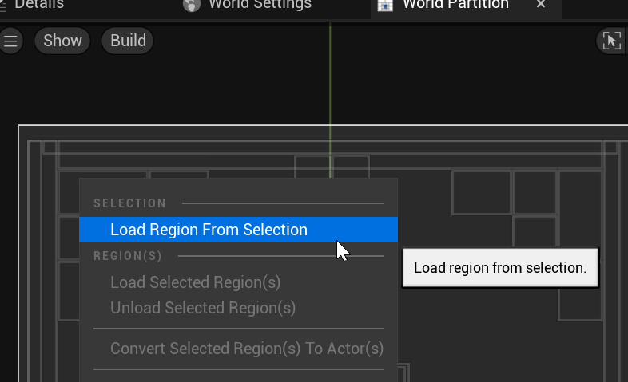
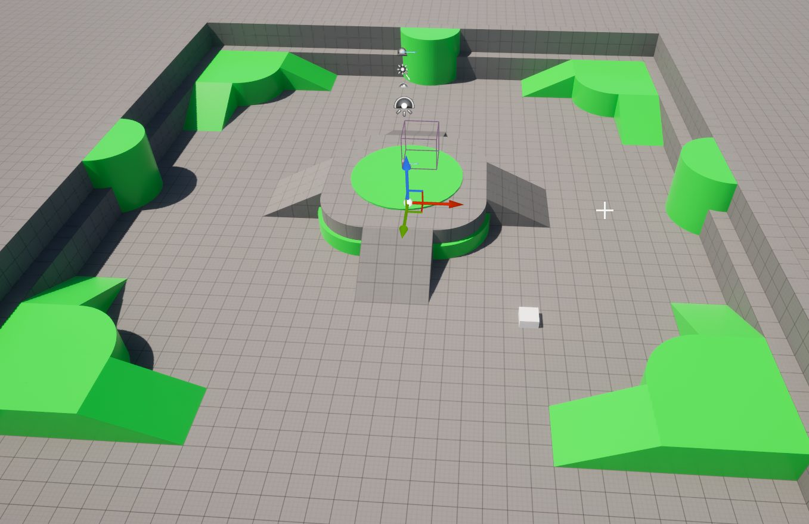

# Unreal: World Partition: Enabling World Partition

> Legacy lesson, organized for self-study. Screenshots may show an older editor. See the Unreal 5.8 verification scope (legacy attachment omitted) before relying on version-specific steps.

The World Partition is enabled through use of *Streaming*.

## Enabling World Partition

Open Window -\> World Settings.

*Figure: Screenshot of Window -\> World Settings.*

Enable Streaming.

*Figure: Screenshot of "Enable Streaming" in the World Settings.*

## Showing Region

Enabling streaming in a world will remove all actors by unloading them.

*Figure: Screenshot showing unloaded actors.*

The actors must be loaded by *region*.

When using the World Partition, actors will only be loaded when asked in the Editor. This keeps the memory usage lower in larger, open world spaces.

To see the actors, open the World Partition Editor.

Go to Window -\> Window -\> World Partition -\> World Partition Editor. (This will generally open next to Details.)

*Figure: Screenshot of World Partition Editor window.*

Click and drag a selection of the actors to add.

*Figure: Screenshot of selected actors.*

Right-click and choose "Load region from selection."

*Figure: Screenshot showing the "Load Region From Selection" option.*

This will load the actors into the world.

*Figure: Screenshot showing the loaded region in the World Partition.*
