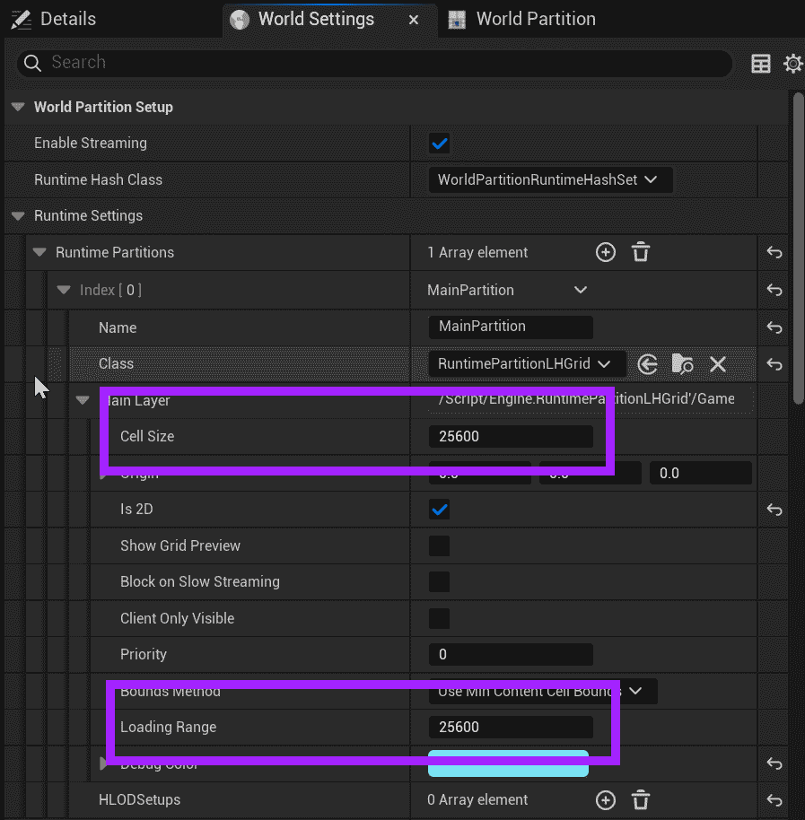

# Unreal: World Partition: What is the World Partition?

> Legacy lesson, organized for self-study. Screenshots may show an older editor. See the Unreal 5.8 verification scope (legacy attachment omitted) before relying on version-specific steps.

In older versions of Unreal, it was possible to configure different volumes (spaces) in a level to perform an action known as streaming. A level could be marked as a host of others, allowing sub-levels and streaming in parts of a larger world. In Unreal 5, this was condensed into new functionality named [World Partition](https://dev.epicgames.com/documentation/en-us/unreal-engine/world-partition-in-unreal-engine).

In this model, a "world" is created as a series of cells defined within a grid pattern. Based on the movement of a single actor (generally Player Character), cells are streamed into the world.

## *What is a cell?*

In the World Partition model, a cell is a defined section of the world. This closely connected to the Loading Range.

*Figure: Screenshot of Cell Size and Loading Range.*

In the World Partition model, the Loading Range defines when the next part of the world, cell, should be loaded in reference to the current position of the player character moving through the world. Generally, we want to load one cell in "front" of us as we are approaching it and upload the cell "behind" us as we move away from it.
